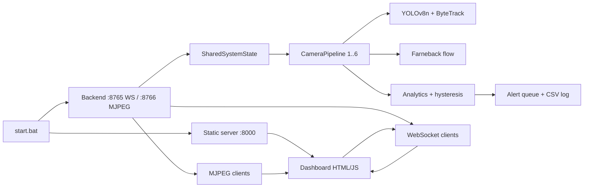
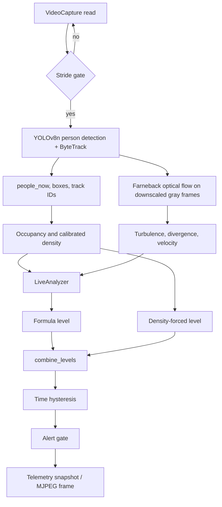
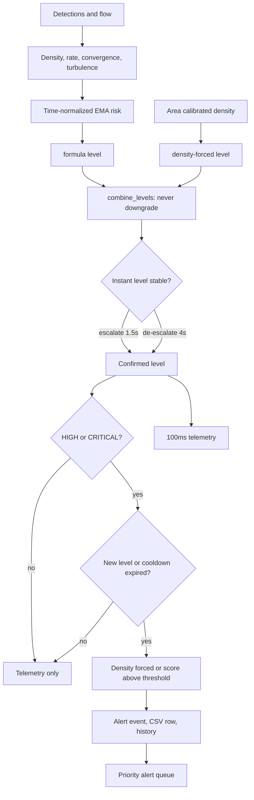
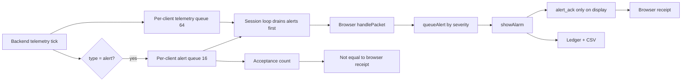
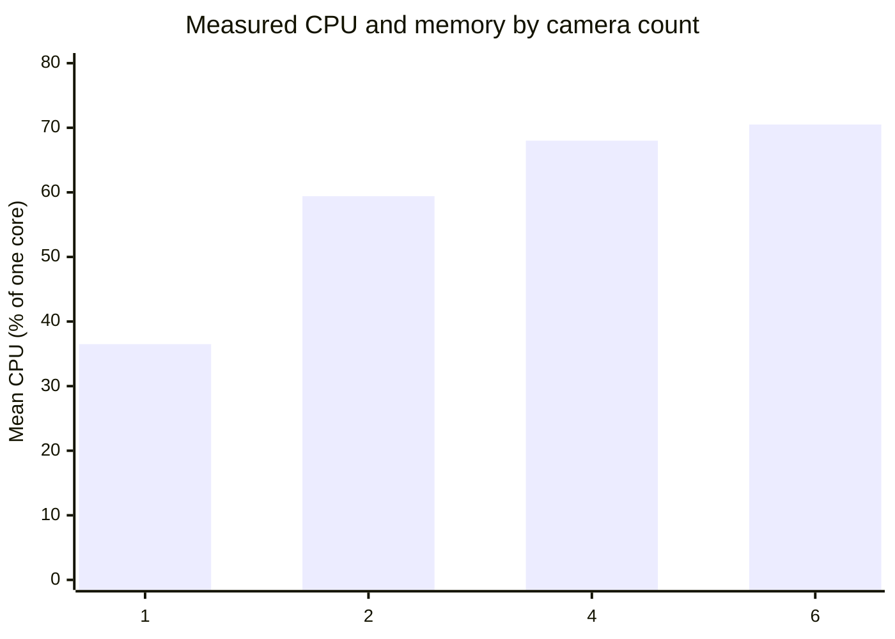
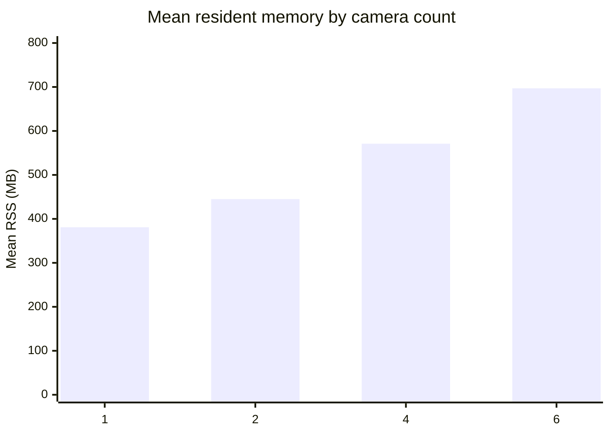

# Alert Vision: Design and Experimental Evaluation of a Multi-Camera Crowd-Monitoring Prototype

**Author:** [Author name], [Affiliation]  
**Contact:** [email]  
**Artifact version:** Backend 2.1.0, repository commit `93b7481`  
**Date:** 25 November 2026

---

## Abstract

—This paper presents the design, implementation, and experimental evaluation of Alert Vision, a multi-camera crowd-monitoring prototype that combines person detection, multi-object tracking, optical-flow analysis, heuristic risk scoring, and real-time dashboard telemetry. The system uses YOLOv8n for person detection and ByteTrack for per-camera track continuity, computes motion-derived turbulence, convergence, and velocity signals from Farneback optical flow, and combines these with count-based and optionally calibrated density indicators to produce one of four risk levels: SAFE, MODERATE, HIGH, and CRITICAL. The engineering contribution is the integration of these components into a loopback-bound architecture with time-normalized analytics, priority-ordered emergency alerts, explicit separation of queue acceptance from browser receipt, bounded camera reconnection, and a fail-closed launcher. The prototype was evaluated on a Windows 11 host with an AMD Ryzen 7 7435HS processor using synthetic MJPEG streams and a real backend process. Measured configurations of one, two, four, and six cameras produced mean CPU utilisation of 36.5%, 59.4%, 68.0%, and 70.5%, mean resident memory of 381 MB, 445 MB, 571 MB, and 697 MB, and telemetry intervals of approximately 107–112 ms. A single MJPEG client received approximately 22.5–22.8 frames per second. The paper explicitly distinguishes verified implementation properties from unverified accuracy claims: detection recall, identity-switch rate, physical density accuracy, and time-to-critical prediction are not validated. Alert Vision is therefore described as a decision-support engineering prototype, not as a system capable of reliably predicting or preventing crowd disasters.

**Index Terms**—crowd monitoring, computer vision, YOLOv8, ByteTrack, optical flow, crowd density, risk assessment, real-time telemetry, multi-camera systems.

---

## I. Introduction

Crowd monitoring systems are increasingly deployed in transport hubs, public events, and enclosed venues where operators need timely information about crowding and movement. Computer vision offers a practical route to such information because existing closed-circuit television infrastructure can be reused without wearable sensors or physical instrumentation. A typical pipeline detects people, associates detections across frames, estimates density or movement, and raises an alert when a heuristic threshold is crossed.

However, a research prototype becomes useful in operation only when the surrounding engineering is reliable. Camera streams fail, browsers become slow, model loading takes time, dependency installation may be incomplete, and operators need to distinguish "connecting" from "failed". A system that drops an emergency message because a telemetry queue is full, or that reports an accepted WebSocket message as a browser receipt, is unsafe even if its detector is accurate.

Alert Vision addresses these issues as an engineering prototype. It keeps a pure analytics module for risk mathematics and a threaded backend for capture, inference, telemetry, and alert delivery. The dashboard is a browser client connected over WebSocket, with an MJPEG relay for live annotated video. This paper documents:

1. the architecture of the multi-camera pipeline;
2. the implemented detection, tracking, density, optical-flow, and risk methods;
3. the reliability mechanisms for camera connection, alert priority, and delivery semantics;
4. an experimental evaluation on one, two, four, and six cameras; and
5. the limitations that prevent safety or prediction claims.

The contribution is integration and engineering: the individual algorithms are established methods from prior work, while the prototype combines them with explicit uncertainty communication and measurable failure behaviour. The system does **not** claim to predict or prevent stampedes, and it does not perform cross-camera identity tracking. The remainder of the paper reviews relevant literature, specifies the architecture and implemented methods, describes the experimental protocol, reports measured results, and states the limitations that constrain interpretation.

## II. Problem Statement and Research Motivation

The central problem is to provide an operator with a timely, interpretable, and honest view of crowd conditions from several video streams on ordinary hardware. This problem decomposes into four subproblems.

First, **multi-camera ingestion** must tolerate sources that are unreachable, slow, or temporarily unavailable. A single blocking camera open would delay all telemetry. Alert Vision therefore opens streams in per-camera worker threads with bounded capture timeouts and loads the model in a separate thread while raw frames are relayed to the dashboard.

Second, **crowd-state estimation** must combine complementary indicators. A people count alone does not capture movement; a motion signal alone does not capture occupancy. The prototype combines detection count, bounding-box occupancy, optional area-normalised density, and Farneback-derived motion signals. These are heuristic indicators, not calibrated physical measurements unless a calibrated floor area is supplied.

Third, **risk communication must be temporally consistent**. If smoothing is applied per frame, the same real-world change will be scored differently at different frame rates or inference strides. Alert Vision normalizes its EMA and rate-of-change terms by measured elapsed time.

Fourth, **alert delivery must have explicit semantics**. Queue acceptance by a backend is not receipt by a browser. Emergency alerts must not be lost behind routine telemetry, but the system must not report a message as seen merely because it entered a queue. The prototype uses a dedicated alert queue and an explicit acknowledgement sent only when the dashboard displays the alert.

These problems motivate an architecture in which reliability and honesty are treated as first-class design constraints alongside computer-vision accuracy.

## III. Related Work and Literature Review

Crowd safety research has long used spatial density as an indicator of pedestrian level of service. Fruin's pedestrian planning work established density-based descriptors of walking conditions [1]. Later simulation work by Helbing, Farkas, and Vicsek showed that jamming, clogging, and incoordinated movement can arise in dense pedestrian crowds [2]. These studies motivate monitoring density and movement, but they do not establish that a simple camera pipeline can predict a specific dangerous event.

Object detection provides the person observations required by such a pipeline. The YOLO family reformulated detection as a single-pass regression problem and enabled real-time inference [3]. Ultralytics' YOLOv8 implementation is used in this prototype as an established detector and tracker integration [4]. Multi-object tracking is required because frame-wise detections do not provide continuity. ByteTrack associates both high- and low-confidence detections with existing tracklets and reports strong tracking benchmarks [5]. Alert Vision uses the configured `bytetrack.yaml` tracker through Ultralytics' `model.track(persist=True)` interface; it does not implement a new tracker.

Crowd counting and density estimation have also been studied extensively. Zhang et al. proposed a multi-column convolutional neural network for single-image crowd counting [7]. Sindagi and Patel surveyed CNN-based crowd counting and density-map methods [8], and Wang et al. provide a recent survey of crowd density estimation and counting [9]. Alert Vision differs from these approaches: it does not train a density-regression network. It uses detected-person count and, when geometry is configured, a single-camera area estimate. Consequently its people/m² value is an estimate, not a learned density map.

Optical flow is used to characterise motion. Farnebäck's polynomial-expansion method [6] is implemented in OpenCV [12] and is used here on downscaled grayscale frames. Unlike optical-flow research that seeks accurate flow fields, Alert Vision derives coarse proxies: angular turbulence, a motion-masked divergence proxy, and mean velocity. The system compensates median translation and a least-squares radial zoom component, but it does not model occlusion or lighting change.

Surveys of real-time visual crowd analysis and smart-video surveillance [10], [11] identify detection, tracking, density estimation, and behaviour analysis as recurring components. Alert Vision fits this pattern but contributes an implementation-level account of telemetry cadence, alert priority, browser receipt, and measured resource use, which are often omitted in algorithm-focused papers.

A second distinction concerns the role of density. Learned density-map methods estimate a per-pixel count distribution and often require large annotated datasets [7]–[9]. Alert Vision instead uses a detected bounding-box count plus a geometric area estimate. This choice trades estimation accuracy for deployability: the prototype can run with `yolov8n.pt` and no custom training data. The trade-off is reported honestly in the interface: when area is absent, the people/m² field is not interpreted as a physical measurement. Likewise, optical-flow descriptors are used as relative indicators of movement rather than as estimates of real-world velocity. The paper therefore evaluates system behaviour and resource cost, not the accuracy of crowd physics.

Tracking research also distinguishes identity continuity from identity uniqueness. ByteTrack improves association by recovering low-score detections [5], but identifiers remain valid within a camera and a tracking session. Re-identification across cameras requires additional appearance models and calibration that Alert Vision does not implement. The prototype's track counter is explicitly labelled as cumulative IDs rather than a headcount. This is a deliberate reporting choice: a monotonic counter must not be presented as a measure of distinct people.

Real-time video analytics adds constraints that offline crowd-counting studies may not emphasise: bounded latency, backpressure, client heterogeneity, and failure visibility [10], [11]. Alert Vision addresses these through fixed telemetry intervals, bounded queues, explicit alert priority, and connection diagnostics. These are implementation properties that can be tested without labelled data, which is why they are reported as verified. The paper does not attribute them to the cited algorithms; the citations establish the background methods, while the evaluation concerns the prototype built from them.

## IV. Proposed System Architecture

Fig. 1 shows the overall architecture. The system runs three local processes: a whitelist static server on port 8000, the backend on ports 8765 and 8766, and a launcher that starts the browser helper and backend. All listeners bind to `127.0.0.1`. The backend has an asyncio event loop for WebSocket clients, a `ThreadingHTTPServer` for MJPEG and health, and up to six camera worker threads.

Each camera worker owns a capture handle, a YOLOv8n model instance, tracking state, flow buffers, and a latest-frame snapshot protected by a frame lock. A separate per-camera model-loader thread loads YOLO while capture is being established. Model loading failures are published as `model_error`, and the UI shows an `UNKNOWN` risk state rather than a measured level.

The data path is summarised in Fig. 2. A captured frame is optionally downscaled to a maximum width of 640 pixels. Inference is performed on every Nth captured frame, where N is the configured stride (1–10). Detections are filtered to the person class, and track identities are obtained from ByteTrack. The worker computes occupancy and motion signals, updates the risk analyser, applies hysteresis, and may emit an alert. A snapshot is published to WebSocket clients every 100 ms; annotated JPEG frames are simultaneously available to the MJPEG relay.

Shared state is deliberately limited. Configuration, camera registry, and alert history are protected by a re-entrant state lock. Frame and JPEG snapshots use a frame lock. Connection diagnostics use a dedicated lock so a telemetry packet contains a consistent state, error, elapsed time, and masked source. Capture-handle release is performed only by the owning worker thread after `stop()` joins that thread; this avoids releasing a handle during a concurrent read.

Connection handling is designed for diagnosis as well as recovery. Streams are opened with `CAP_FFMPEG` and four-second timeouts. For DroidCam URLs on port 4747, the worker tries `/video`, then `/mjpegfeed?640x480`, then `/mjpegfeed`; a 0.6 s host probe prevents repeated timeouts when the host is unreachable. A failed attempt produces a readable reason such as a timeout or connection refusal. Reconnect delay grows 2, 4, 8, 16, and 30 s and resets after success. Camera removal stops pipelines outside the registry lock, because joining a worker can take up to five seconds and would otherwise stall telemetry.

Model loading is moved to a separate per-camera thread. While the model is unavailable, the worker relays raw frames and publishes risk level `UNKNOWN`. The dashboard represents this as "MODEL LOADING" rather than as a failed camera or a measured SAFE state. This separation addresses a common failure mode in which a slow model load appears to the operator as a dead stream.

Telemetry and video are intentionally separated. WebSocket packets are small JSON snapshots emitted on a fixed tick and are suitable for state, alerts, and diagnostic fields. MJPEG carries visual evidence but is heavier and is consumed by `` elements. Separating them allows telemetry to remain responsive when video encoding slows, and allows the dashboard to display an explicit NO SIGNAL state when a stream stalls. Both channels are served from loopback-only listeners; the health endpoint provides a minimal state summary for the launcher and diagnostic tools.

TABLE I summarises the externally visible contracts. These contracts were kept backward compatible: telemetry fields were added, not renamed.

**TABLE I**  
**EXTERNAL CONTRACTS OF THE PROTOTYPE**

| Interface | Contract |
|---|---|
| WebSocket `ws://127.0.0.1:8765` | Additive JSON types: `telemetry`, `alert`, `history`, `config_ack`, `config_error`, `test_result`, `state` |
| MJPEG `http://127.0.0.1:8766/video?cam=<id>` | Multipart stream with boundary `frame`; `/frame.jpg?cam=<id>` for one frame |
| Health `http://127.0.0.1:8766/health` | JSON with status, version, camera counts, model state, and client counts |
| Dashboard `http://127.0.0.1:8000/` | Whitelisted static files: `/`, `/index.html`, `/script.js` |
| CSV log | `Timestamp,CameraID,CameraLabel,RiskLevel,RiskScore,DetectionConfidence,People,ActionRequired,AlertID` |
| Limits | Maximum six cameras; model `yolov8n.pt` is read-only |

**Fig. 1.** Overall system architecture. The launcher starts the static server and backend; the backend owns camera pipelines, analytics, alert logging, WebSocket telemetry, and MJPEG relay.

**Fig. 2.** Multi-camera processing pipeline. Each camera thread executes this pipeline independently; stride reduces the rate of analytics but not necessarily the rate of raw frame relay.

## V. Methodology

### A. Person Detection Using YOLOv8n

The detector is YOLOv8n, the nano variant distributed through Ultralytics [4]. Frames wider than `MAX_FRAME_WIDTH = 640` are resized with `INTER_AREA` before inference. The model is invoked with `model.track(...)`, `persist=True`, `classes=[0]`, and a configurable confidence threshold clamped to 0.05–0.95. The person class identifier is zero in the COCO label space used by the model.

For each retained bounding box, the prototype records box coordinates, detection confidence, and track identity. It accumulates the total bounding-box area and computes an occupancy fraction,

$$
\rho_{\text{frame}} = \frac{\sum_i (x_{2,i}-x_{1,i})(y_{2,i}-y_{1,i})}{W H},
$$

where W and H are the resized frame dimensions. This quantity is a screen-space occupancy proxy; it is not people per square metre.

### B. Multi-Object Tracking

Tracking is provided by ByteTrack through Ultralytics' tracker configuration `bytetrack.yaml`. The project does not implement its own association algorithm. Track IDs are stored in a per-camera cumulative set, capped and cleared at 512 entries. The telemetry field `unique_ids` is retained for compatibility but accompanied by `track_ids_seen` and an explicit meaning string: "cumulative ByteTrack IDs (includes re-identifications; NOT unique people)". No identity is shared across cameras, and the system makes no cross-camera re-identification claim.

### C. Crowd Density Estimation

Two density-related quantities exist. The uncalibrated, count-normalised term is

$$
d^{count}_t = \mathrm{clip}\left(\frac{n_t-(m-1)}{(m+4)-(m-1)},0,1\right),
$$

where nₜ is the detected person count and m is `min_people`, defaulting to three. When a calibrated visible floor area A is supplied, the prototype computes

$$
p_t = n_t / A,\qquad
d^{psm}_t = \mathrm{clip}\left(\frac{p_t-1}{6-1},0,1\right).
$$

The combined density term is $d_t=\max(d^{count}_t,d^{psm}_t)$, so calibration can add risk but cannot reduce the count-derived term. If A is not supplied, the UI displays "not calibrated" rather than a measured zero. The density gates are 4 people/m² for HIGH and 6 people/m² for CRITICAL, following the project's documented anchors, but the prototype does not empirically calibrate these thresholds against local video.

### D. Optical Flow Analysis Using Farneback Optical Flow

Farneback optical flow is computed on half-resolution grayscale frames. The global median flow vector is subtracted from both components to compensate camera translation. Motion pixels are selected by magnitude greater than 0.3 pixels. For the angular turbulence signal, let θ be the flow angle at a moving pixel. The turbulence measure is

$$
\tau = 1 - \left| \frac{1}{N}\sum_{k=1}^{N} e^{i\theta_k} \right|.
$$

Values near zero indicate aligned motion; values near one indicate dispersed directions. Divergence is approximated from the gradient of the median-compensated flow, and a least-squares radial component is removed to reduce the effect of camera zoom. The divergence is normalised by measured elapsed time, and velocity is reported in pixels/second:

$$
v = \frac{1}{\Delta t N}\sum_{k=1}^{N}\sqrt{f_{x,k}^{2}+f_{y,k}^{2}}.
$$

These are heuristic motion descriptors, not calibrated physical flow measurements.

### E. Crowd Movement and Convergence Analysis

Convergence is derived from the divergence proxy and the moving-person presence term. Let D be the rolling window of divergence samples. The convergence signal is

$$
c_t = \mathrm{clip}\left(\frac{-d_t}{3\,\sigma(D)+10^{-9}},0,1\right)\,p_t,
$$

where $p_t=\mathrm{clip}(n_t/m,0,1)$ gating by detection presence. Negative divergence (apparent convergence) increases the signal; positive divergence does not. Presence gating suppresses motion signals when no people are detected.

### F. Risk Assessment and Alert Generation

The risk score uses four weighted terms: density, rate of change, convergence, and turbulence. The default weights are 0.4, 0.2, 0.2, and 0.2. To remove frame-rate dependence, the EMA coefficient is computed from measured Δt relative to a nominal 15 FPS interval:

$$
\alpha(\Delta t)=1-(1-0.25)^{\Delta t/(1/15)}.
$$

The rate term is

$$
r_t=\mathrm{clip}\left(\frac{\max(d_t-d_{t-1},0)}{\Delta t \cdot 2.0},0,1\right).
$$

The instantaneous weighted score is

$$
s_t = \mathrm{clip}\left(
\frac{w_d d_t + w_r r_t + w_c c_t + w_\tau \tau_t}
{w_d+w_r+w_c+w_\tau},0,1\right),
$$

and the smoothed score is $R_t=(1-\alpha)R_{t-1}+\alpha s_t$. A zero count resets the smoothed risk to zero.

The formula level maps Rₜ to SAFE, MODERATE, HIGH, or CRITICAL using a threshold θ and critical value 0.85. Density-forced levels can only raise the level. Time hysteresis requires 1.5 s to escalate and 4 s to de-escalate. An alert is generated for a new HIGH or CRITICAL level, or after a 30 s cooldown, provided the density gate fired or the score exceeded the alert threshold.

The time-to-critical value is a least-squares linear trend over recent EMA samples. It is emitted only when there are at least six samples spanning at least two seconds, with a positive slope and a result within 180 s. The UI renders it as `~Xs (est)`, and the telemetry payload includes slope, R², sample count, and the caveat "estimate only; not a calibrated prediction". Absence of an estimate is not interpreted as absence of risk.

A confidence indicator is computed separately from the risk score from the mean detection confidence and a warm-up ramp based on the number of samples. This value describes the maturity and confidence of the detection stream; it is not a probability that the risk level is correct. The prototype also publishes the individual risk terms so an operator can see whether a level was driven by density, rate of change, convergence, or turbulence. This transparency is useful precisely because the weights were not calibrated against incident data.

The hysteresis policy is asymmetric by design. Escalation requires 1.5 s of sustained evidence, whereas de-escalation requires 4 s. This reduces rapid oscillation between HIGH and SAFE when detections fluctuate near a threshold. Density-forced levels bypass the slow escalation path because the density gates represent explicit policy thresholds; however, clearing a forced level uses a majority vote over eight recent density levels. The design prioritises not missing a sustained high-density condition over immediate recovery, while still preventing a single noisy frame from holding an alert state indefinitely.

Fig. 3 summarises the complete analytics-to-alert workflow, including the asymmetric hold times and the density-vote clearing rule.

**Fig. 3.** Crowd analytics workflow and risk-to-alert transition. Density-forced levels escalate immediately; de-escalation is delayed.

## VI. System Implementation

### A. Backend Architecture

The backend process contains the WebSocket event loop, MJPEG relay, camera registry, and CSV writer. Each camera is a `CameraPipeline` with its own worker thread. The worker opens the capture outside the capture lock, maintains connection state, reads frames, performs analytics, and publishes snapshots. Reconnect delay grows exponentially from 2 s to a cap of 30 s and resets on success. DroidCam URLs on port 4747 are tried at `/video`, then `/mjpegfeed?640x480`, then `/mjpegfeed`; a short TCP probe avoids burning multiple timeouts when the host is unreachable.

### B. Multi-Camera Processing

The registry supports at most six cameras. Adding a camera creates a new pipeline; removing one stops it outside the registry lock to avoid stalling telemetry. Hot-swapping a source queues a pending source that is applied only by the owning worker. A source change resets flow history and analyser state. Connection diagnostics are published for every camera through a `connection` object containing state, readable error, elapsed milliseconds, and a masked resolved URL. Credentials are masked everywhere.

### C. Frontend Dashboard

The browser dashboard renders one tile per camera with a live MJPEG image, status chip, people count, score badge, and focus panel. The status chip is driven by backend `connection.state` and shows a live elapsed counter during connecting. A model-loading state is distinct from connection failure. The focus panel shows UNKNOWN while the model loads rather than displaying a measured SAFE state. Uncalibrated density is shown as "not calibrated".

The event ledger records alerts, suppresses duplicate alert IDs, supports clearing and CSV download, and displays a real event count. CSV cells are quoted with formula-injection protection. The viewport DOM is synchronised incrementally: only changed camera sources re-attach their `` streams.

### D. WebSocket Communication

Telemetry packets are broadcast every 100 ms. Each client session has a 64-slot telemetry queue and a 16-slot alert queue. The send loop drains alerts first. If telemetry backs up, routine packets may be dropped, but alerts are not dropped because of telemetry congestion. `broadcast()` returns the number of client queues that accepted a message. This is explicitly documented as queue acceptance.

### E. MJPEG Video Streaming

The MJPEG relay serves multipart frames from the latest annotated JPEG. Each tile uses an `` element with a watchdog and bounded retry backoff. When telemetry indicates an offline-to-online transition, the dashboard re-attaches the stream. The relay advertises a 25 fps sleep target; measured delivery to one client was approximately 22.5–22.8 fps.

### F. Alert Logging and Acknowledgement

An alert event has a lifecycle. It is queued in the camera pipeline, dispatched to client queues, acknowledged by the browser, or released after a grace period. The browser sends `alert_ack` only from the function that displays the banner. Thus a queue-accepted alert that was never displayed is not reported as received. Alerts are also written to CSV through a bounded retry queue and replayed to new WebSocket clients from alert history.

Failure handling is intentionally explicit. The WebSocket handler logs exceptions instead of swallowing them; CSV writes stop retrying after a bounded count and surface a `log_error` badge; slow clients can have non-alert messages dropped without blocking other clients; and the launcher aborts on pip or import failure before starting the static server. The launcher opens the browser through a hidden background helper that polls health once per second for at most 90 s, then cleans up by recorded process identifiers rather than terminating unrelated processes. These mechanisms are not computer-vision contributions, but they determine whether an early-warning prototype behaves predictably in use.

The dashboard's alert queue is severity-ranked. When a new alert arrives, it is displayed immediately if no alert is active or if its severity exceeds the active alert. Otherwise it is queued. When the active banner clears, the highest-severity queued alert is shown next. A displaced lower-severity alert is not discarded. Duplicates are suppressed by alert identifier, preventing the ten-hertz telemetry channel from re-triggering the banner or ledger.

Security is limited by design. All services bind to loopback. The static server uses a component-wise path check and a file whitelist. Camera credentials are masked in logs and telemetry and excluded from browser storage. The WebSocket server uses an Origin allow-list but no token authentication, and there is no TLS. The prototype is therefore suitable for local operation on a trusted machine, not for untrusted network exposure. The CSV export applies quoting and formula-injection guards, but exported files should still be treated as untrusted input when opened in spreadsheet software.

Fig. 4 summarises the dashboard communication path and marks the point at which queue acceptance is distinguished from browser receipt.

**Fig. 4.** Dashboard and communication architecture, including the distinction between queue acceptance and browser receipt.

## VII. Experimental Setup

Experiments were conducted on the development host described in Table II. The benchmark harness started synthetic MJPEG servers and the real backend process, connected a real WebSocket client, pushed a configuration containing N cameras, waited for all cameras to report connected, sampled telemetry intervals, sampled backend CPU and resident memory over the process tree, and fetched one MJPEG stream to count frame boundaries.

Synthetic sources were used because the repository's verification tooling intentionally uses `tools/fake_mjpeg.py` for deterministic connect timing. Physical DroidCam hardware was not used in this audit run. The saved dashboard configuration re-pushes camera settings on WebSocket reconnect, so source-level verification should be run without an open dashboard tab.

The verification suite contains 64 automated tests spanning unit logic, analytics scenarios, frontend source contracts, security checks, performance-harness contracts, integration with a real backend, and stress behaviour. The full suite passed at the reported commit. Connection timing was measured with `tools/verify_connect.py`, and performance with `tools/benchmark_multicam.py --counts 1 2 4 6 --seconds 6`.

CPU and memory were sampled over the whole backend process tree because the Windows Python launcher may spawn the real interpreter as a child. CPU was computed from `cpu_times()` deltas over 0.5 s windows and normalised to one core. Telemetry interval was measured from real WebSocket packets rather than inferred from the configured 100 ms tick. MJPEG rate was measured by counting multipart boundaries on one stream for three seconds.

Two experimental conditions limit interpretation. First, the streams are synthetic and depict a static scene; they exercise capture, inference, encoding, and scheduling but not real crowd dynamics. Second, only one WebSocket client and one MJPEG client were active. The 12-client × 6-camera case remains future work. Because no labelled crowd video was used, the benchmark cannot support any statement about detection or tracking accuracy.

**TABLE II**  
**EXPERIMENTAL ENVIRONMENT**

| Item | Value |
|---|---|
| Operating system | Windows 11 Home Single Language, build 26300 |
| Machine | Lenovo 83JC |
| Processor | AMD Ryzen 7 7435HS, 8 cores / 16 logical processors |
| Memory | 24,261 MB |
| Inference device | CPU; `device="cpu"` at inference call sites |
| Model | `yolov8n.pt`, 6,549,796 bytes, read-only |
| Python | 3.11 project virtual environment |
| Camera sources | Synthetic 15 fps MJPEG streams from `tools/fake_mjpeg.py` |
| Telemetry sampling window | 6 s per camera count |
| MJPEG sampling window | 3 s for camera 1, one client |
| Verification suite | 64 tests, 11 test files |

## VIII. Results and Performance Evaluation

Table III reports the measured results. All four benchmark runs completed successfully, all requested cameras reached the connected state, and the model was loaded by the time of measurement.

**TABLE III**  
**MEASURED PERFORMANCE ACROSS CAMERA COUNTS**

| Cameras | All-online time (ms) | Mean CPU (% core) | Mean RSS (MB) | Telemetry average (ms) | MJPEG FPS, one client |
|---:|---:|---:|---:|---:|---:|
| 1 | 110 | 36.5 | 381 | 112 | 22.8 |
| 2 | 172 | 59.4 | 445 | 112 | 22.7 |
| 4 | 547 | 68.0 | 571 | 107 | 22.6 |
| 6 | 1078 | 70.5 | 697 | 108 | 22.5 |

Figs. 5 and 6 plot the CPU and memory columns of Table III directly.

**Fig. 5.** Mean CPU utilisation for one, two, four, and six cameras. Data source: `docs/PERFORMANCE.md`.

**Fig. 6.** Mean resident set size for the same runs. Data source: `docs/PERFORMANCE.md`.

The all-online time rose from 110 ms at one camera to 1078 ms at six cameras. This increase is expected because each camera independently opens a stream and loads a model instance. Memory grew approximately linearly, from 381 MB to 697 MB mean RSS, consistent with a separate YOLOv8n instance per camera. CPU utilisation increased from 36.5% to 70.5% mean, but was not strictly monotonic between two and four cameras; the benchmark documentation treats the values as observed ranges because YOLO uses multiple Torch threads and the sampler uses 0.5 s windows.

Telemetry intervals remained close to the 100 ms design target, with means between 107 ms and 112 ms. A maximum observed interval of 187–188 ms indicates occasional scheduling delay, not sustained backlog, under one WebSocket client. MJPEG delivery to one client remained around 22.5 fps, below the 25 fps sleep target because JPEG encoding is performed in the camera worker.

The CPU and memory trends suggest that the dominant scaling cost is per-camera model inference rather than telemetry fan-out. Telemetry remains nearly constant despite a six-fold camera increase, while RSS grows by roughly 316 MB from one to six cameras. A shared inference process or batched execution could reduce this cost but would change the isolation model: the current design lets one camera fail without affecting others. The observed trade-off is therefore memory and CPU for per-camera isolation.

The all-online measurement includes model loading and stream connection. Its growth to 1078 ms at six cameras is acceptable for a local prototype but indicates that startup time scales with camera count. The connection verification separately showed 2641 ms to first connected state and 4641 ms to a readable failure, both within the project's defined thresholds. These are system-level responsiveness measurements, not detection-latency guarantees.

Table IV further separates steady-state inference cost from startup cost. After warm-up, `model.track()` required roughly 31 ms at both tested resolutions on this CPU, with a 54 ms p95 outlier at the smaller input caused by thread scheduling. The benchmark intentionally avoids drawing an accuracy conclusion from resolution: no labelled people were present, so it measures compute time only. This distinction matters because a faster configuration is not necessarily safer.

A threat to validity is the use of a static synthetic scene. Real crowds introduce occlusion, scale variation, motion blur, illumination change, and foreground/background ambiguity. These factors affect both detection and optical flow but are absent from the benchmark. The measurements therefore support claims about pipeline cost and responsiveness, not about behaviour under realistic crowd scenes.

Table IV reports YOLO tracking latency on synthetic frames after warm-up. These values are latency measurements only and imply no accuracy claim.

**TABLE IV**  
**YOLO TRACK LATENCY ON SYNTHETIC FRAMES, CPU, 10 ITERATIONS**

| Input resolution | Mean (ms) | p50 (ms) | p95 (ms) |
|---|---:|---:|---:|
| 320 × 240 | 33.48 | 31.43 | 54.25 |
| 640 × 480 | 30.74 | 30.69 | 31.80 |

Table V summarises the verification evidence that accompanies the performance results. The connect timings satisfy the project's own thresholds of 3 s for connected and 6 s for readable failure.

**TABLE V**  
**VERIFICATION EVIDENCE SUMMARY**

| Check | Result |
|---|---|
| `py_compile` for backend, analytics, CLI, static server, and tools | Pass |
| Full `pytest -q` suite | 64 passed, 0 failed |
| Synthetic camera connected | 2641 ms, pass against 3000 ms target |
| Unreachable source failed | 4641 ms, pass against 6000 ms target, readable reason |
| Multi-camera benchmark | 4/4 runs successful |
| Clean-venv dependency dry run | Resolved pytest 9.2.0 within `>=8.3.3,<10` |
| Tracked `.pyc` files | 0 |

## IX. Discussion

The results support a narrow conclusion: the prototype can run up to six synthetic camera streams on the tested CPU while maintaining telemetry cadence and bounded connection behaviour. They do not establish detection accuracy, safety effectiveness, or generalisability to other hardware.

The main engineering contribution is the separation of concerns. Detection and tracking are delegated to established libraries. The analytics module is pure and testable. The backend owns concurrency and delivery semantics. The dashboard owns presentation and user acknowledgement. This separation allowed specific properties—alert priority, connection consistency, and honest failure states—to be tested independently.

The alert design is particularly important. A telemetry queue can be dropped under load, but an emergency alert should not be dropped because of unrelated telemetry volume. The two-queue design enforces that priority. The delivery lifecycle further prevents the common mistake of treating queue acceptance as user receipt. The frontend severity queue prevents a lower-severity alert from replacing an active higher-severity banner, while still preserving the lower-priority alert for later display.

The time-normalized analytics improve internal consistency. A rate term computed per frame and an EMA computed per sample would change meaning with stride; the implemented formulas make the score comparable across sampling intervals. This is a methodological improvement for the prototype, although the weights themselves are not calibrated against real incidents.

Scalability is limited by CPU inference and memory. Six cameras use roughly 700 MB RSS and about 70% of one core on the test host, but the system has no mechanism to share a model instance or batch frames across cameras. The non-monotonic CPU result between two and four cameras suggests measurement noise and thread scheduling effects; more repetitions would be needed for a capacity model.

The design also makes a deliberate distinction between observed behaviour and claimed assurance. Tests demonstrate that alerts are prioritised under a synthetic backlog and that browser receipt follows display. They do not demonstrate that an operator will respond appropriately, that the alarm is audible in a noisy venue, or that the chosen thresholds reflect a real crowd hazard. These questions require human-factors and field studies beyond the scope of this engineering evaluation.

Uncertainty communication is therefore part of the contribution. The interface refuses to display a measured people/m² value without calibration, labels ETA as an estimate, exposes risk term breakdowns, distinguishes model loading from camera failure, and labels cumulative track IDs explicitly. These choices do not improve a confusion matrix, but they reduce the chance that an operator misreads a heuristic as a measurement. In a decision-support prototype, preventing misinterpretation is as important as the numerical score.

## X. Limitations and Future Scope

The following limitations are explicit:

1. **No accuracy validation.** Detection recall, precision, small-person misses, and ByteTrack identity switches were not measured against labelled data.
2. **No physical density calibration.** People/m² values are derived from a single camera's area estimate. Without calibration, the UI shows "not calibrated" rather than a measured value.
3. **Approximate ETA.** Time-to-critical is a linear extrapolation of an EMA trend with R² and sample count. It is not a scientifically validated prediction.
4. **No cross-camera identity.** Track IDs are camera-local and cumulative; they are not unique people.
5. **Unverified viewer scaling.** The 12-client × 6-camera MJPEG case was not measured.
6. **Synthetic camera benchmark.** Real phone streams, wireless jitter, and DroidCam encoder behaviour were not part of the performance run.
7. **No token authentication or TLS.** Services are loopback-bound; the endpoints are unauthenticated by design and documented as such.
8. **LWCC is not wired.** `ALERT_VISION_LWCC` is reserved; no code path reads it.
9. **Browser interaction QA incomplete.** Audible alarm, ACK button, and full visual tile behaviour were not manually verified in this run; frontend guarantees are source-contract tests.
10. **Documentation inconsistency.** `docs/SECURITY.md` still contains a sentence describing LWCC as "lazily imported"; the code and README show it is not wired. This paper follows the code and README.
11. **No long-duration study.** Memory leakage, stride-10 behaviour, and GPU inference were not measured.

Future work should validate detection and tracking on labelled crowd video, calibrate density against plan-view ground truth, repeat performance tests with physical cameras and multiple viewers, and evaluate the alert thresholds through controlled operator studies. Additional priorities are batching or sharing inference across cameras, adding authenticated remote access only after a threat model is defined, measuring long-duration memory behaviour, and testing stride-10 and GPU configurations. A safety claim would require validation evidence that this prototype does not yet have.

## XI. Conclusion

Alert Vision is a multi-camera crowd-monitoring engineering prototype that integrates YOLOv8n detection, ByteTrack tracking, Farneback optical-flow analysis, heuristic risk scoring, WebSocket telemetry, MJPEG streaming, and alert logging. Its contribution is not a novel detector or tracker but a testable architecture with time-normalized analytics, priority alert handling, explicit queue-acceptance versus receipt semantics, bounded camera connection behaviour, and honest communication of uncertainty. On the tested Windows 11 host, six synthetic cameras ran at 70.5% mean CPU and 697 MB mean RSS while telemetry remained near 100 ms. The prototype's risk levels and ETA are decision-support heuristics, not validated predictions. The system is not presented as capable of reliably predicting or preventing stampedes.

## References

[1] J. J. Fruin, *Pedestrian Planning and Design*. New York, NY, USA: Metropolitan Association of Urban Designers and Environmental Planners, 1971. [Online]. Available: https://catalog.hathitrust.org/Record/010629769

[2] D. Helbing, I. Farkas, and T. Vicsek, "Simulating dynamical features of escape panic," *Nature*, vol. 407, no. 6803, pp. 487–490, Sep. 2000, doi: 10.1038/35035023.

[3] J. Redmon, S. Divvala, R. Girshick, and A. Farhadi, "You only look once: Unified, real-time object detection," in *Proc. IEEE Conf. Comput. Vis. Pattern Recognit. (CVPR)*, 2016, pp. 779–788, doi: 10.1109/CVPR.2016.91.

[4] G. Jocher, J. Qiu, and A. Chaurasia, "Ultralytics YOLO," software, version 8.0.0, Jan. 2023. [Online]. Available: https://github.com/ultralytics/ultralytics and https://docs.ultralytics.com/models/yolov8

[5] Y. Zhang, P. Sun, Y. Jiang, D. Yu, F. Weng, Z. Yuan, P. Luo, W. Liu, and X. Wang, "ByteTrack: Multi-object tracking by associating every detection box," in *Computer Vision – ECCV 2022*, Lecture Notes in Computer Science, vol. 13682. Cham, Switzerland: Springer, 2022, pp. 1–21, doi: 10.1007/978-3-031-20047-2_1.

[6] G. Farnebäck, "Two-frame motion estimation based on polynomial expansion," in *Image Analysis (SCIA 2003)*, Lecture Notes in Computer Science, vol. 2749. Heidelberg, Germany: Springer, 2003, pp. 363–370, doi: 10.1007/3-540-45103-X_50.

[7] Y. Zhang, D. Zhou, S. Chen, S. Gao, and Y. Ma, "Single-image crowd counting via multi-column convolutional neural network," in *Proc. IEEE Conf. Comput. Vis. Pattern Recognit. (CVPR)*, 2016, pp. 589–597, doi: 10.1109/CVPR.2016.70.

[8] V. A. Sindagi and V. M. Patel, "A survey of recent advances in CNN-based single image crowd counting and density estimation," *Pattern Recognit. Lett.*, vol. 107, pp. 3–16, May 2018, doi: 10.1016/j.patrec.2017.07.007.

[9] M. Wang, X. Zhou, and Y. Chen, "A comprehensive survey of crowd density estimation and counting," *IET Image Process.*, vol. 19, no. 1, e13328, 2025, doi: 10.1049/ipr2.13328.

[10] K. Khan, W. Albattah, R. U. Khan, A. M. Qamar, and D. Nayab, "Advances and trends in real time visual crowd analysis," *Sensors*, vol. 20, no. 18, art. 5073, Sep. 2020, doi: 10.3390/s20185073.

[11] A. C. Garcia, J. E. Gorre, J. A. K. Perez, and M. J. Samonte, "Deep learning in smart video surveillance for crowd management: A systematic literature review," in *Proc. 7th Int. Conf. Frontiers Educ. Technol. (ICFET)*, 2021, pp. 144–150, doi: 10.1145/3473141.3473240.

[12] OpenCV, "OpenCV 4.10.0 documentation," 2024. [Online]. Available: https://docs.opencv.org/4.10.0/
